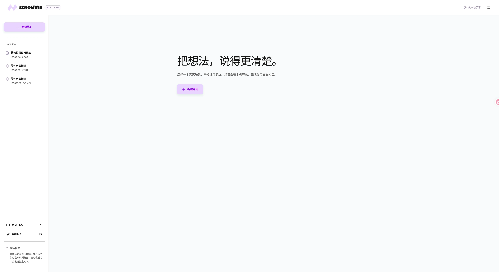
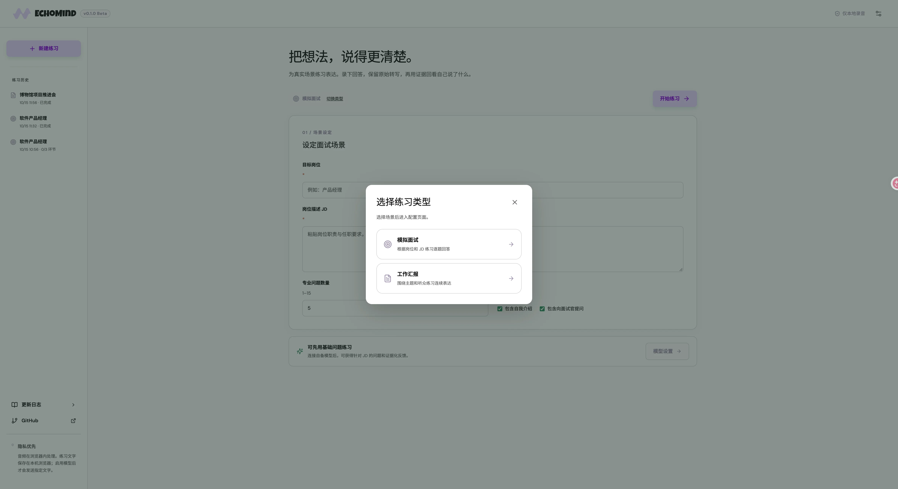
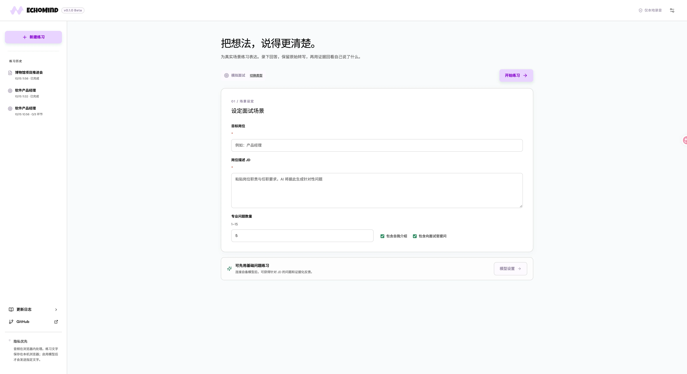
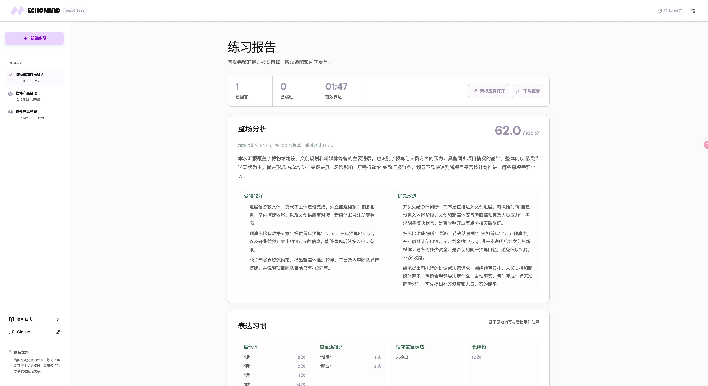
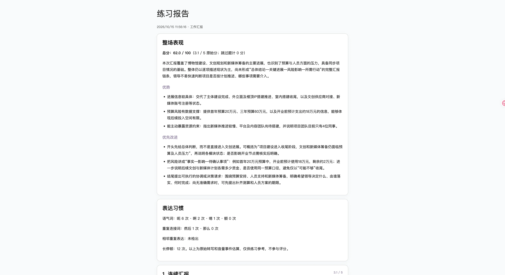

# EchoMind

EchoMind 是一个在浏览器中练习表达的本地应用。它支持模拟面试和工作汇报：录下回答、在本机转写，再按题目回看证据、建议和整场报告。目前处于 Beta 阶段，主要面向 macOS 浏览器。

[查看更新日志](CHANGELOG.md)。应用中也可点击左上角的 Beta 标识，进入 `/changelog` 页面。

## 下载即用（macOS Intel）

从 [GitHub Releases](https://github.com/Suxinljh/EchoMind/releases) 下载 `EchoMind-0.1.0-macos-x64.zip`，解压后双击「Start EchoMind.command」。浏览器会自动打开本机页面；保持终端窗口运行，关闭终端即可停止服务。首次使用时请允许浏览器访问麦克风。发布包内已含本地语音转写模型及 Node.js 运行环境，无需安装 pnpm，也无需另行下载语音模型。

目前发布包面向 **macOS Intel（x64）**。Apple Silicon 设备需安装 Rosetta 2 才能运行这个版本。文字出题和报告分析仍需在设置中配置自己的兼容 OpenAI Chat Completions 的模型服务；发布包不包含 API Key 或在线大模型。

## 功能

- **两种练习场景**：模拟面试根据目标岗位和 JD 逐题回答，可设置 1–15 道专业问题，并选择是否加入自我介绍与反问环节；工作汇报围绕主题、听众、目的和计划要点练习连续表达。
- **录音与本地转写**：浏览器内用 AudioWorklet、Web Worker 和中文 Zipformer 模型处理音频。录音时可查看输入电平、有效时长和实时转录；原始转写保留，语义稿可在报告里修订。
- **从历史继续练习**：左侧按练习时间排列本机历史，可恢复未完成的练习，或打开已完成的报告。
- **整场与逐题报告**：先看按既有维度权重换算的 100 分制总分、整体优势和优先改进，再查看每题的总体评价、评分证据、建议及建议回答方式。语气词、重复表达与长停顿单独展示，仅作练习参考。
- **报告导出**：完成分析后，可在新标签页阅读报告，或下载独立 HTML 文件。
- **自备模型**：可配置兼容 OpenAI Chat Completions 的服务，用于生成针对性问题和文字评估。未配置时仍可使用基础问题；需要模型分析的部分会标明待评估。
- **设备与外观设置**：可保存默认麦克风、测试输入电平，并从 DaisyUI 主题、报纸风和 NeoBrutalism 风格中选择外观。

## 界面预览

以下截图使用示例练习内容；图中的分数和分析仅展示界面效果。

### 首页与练习历史

首页可以新建练习。左侧保留已完成和未完成的练习，便于返回报告或接着练习。



### 选择练习类型

开始时选择模拟面试或工作汇报，再进入对应的场景配置。



### 配置模拟面试

填写目标岗位与岗位描述，设置专业问题数量，以及是否包含自我介绍和面试官提问环节。



### 回看练习报告

报告顶部汇总已回答、已跳过和有效表达时长，随后展示整场得分、优势、优先改进与表达习惯；下方可以切换题目查看详细评价。



### 打开或下载独立报告

导出的 HTML 报告可单独阅读，包含整场表现、表达习惯和逐题内容。



## 本地运行

需要 Node.js 和 pnpm。克隆仓库后：

```bash
pnpm install --frozen-lockfile
```

语音模型文件不进入 Git。运行前请从 [sherpa-onnx 官方模型列表](https://k2-fsa.github.io/sherpa/onnx/pretrained_models/online-transducer/zipformer-transducer-models.html) 下载 **sherpa-onnx-streaming-zipformer-zh-int8-2025-06-30**，解压后将下列文件放入 `benchmarks/private/sherpa-onnx-streaming-zipformer-zh-int8-2025-06-30/`：

```text
encoder.int8.onnx
decoder.onnx
joiner.int8.onnx
tokens.txt
```

也可以直接将这四个文件按 `encoder.onnx`、`decoder.onnx`、`joiner.onnx`、`tokens.txt` 命名，放入 `public/models/zipformer-2025/`。构建脚本会从前一个目录复制并重命名缺失的文件。模型约 160 MB，首次练习加载需要等待。

```bash
pnpm dev
```

打开 <http://127.0.0.1:4174/>。`dev` 会先构建再启动预览服务；修改代码后需要重启命令。这样运行是因为当前 ASR WASM 包在 Vite 热更新模式下无法正确定位 `asr.wasm`。

```bash
pnpm build
```

构建包含 TypeScript 检查，产物写入 `dist/`。

## 部署到 Cloudflare Workers

Cloudflare 部署使用 Workers Static Assets 托管前端，Worker 提供 `/api/model` 和语音模型文件。四个 ASR 模型文件保存在现有 R2 桶 `app` 的 `echomind/` 前缀下，不进入 Git，也不包含在 Workers 静态资源中。

先按上文准备本地模型文件，然后在已登录目标 Cloudflare 账号的机器上上传：

```bash
for name in encoder.onnx decoder.onnx joiner.onnx tokens.txt; do
  pnpm exec wrangler r2 object put "app/echomind/$name" --remote \
    --file "public/models/zipformer-2025/$name" \
    --content-type application/octet-stream
done
```

本地验证并部署：

```bash
pnpm install --frozen-lockfile
pnpm build:cloudflare
pnpm exec wrangler deploy --dry-run
pnpm exec wrangler deploy
```

Cloudflare Workers Builds 连接此 GitHub 仓库时，生产分支选 `main`，构建命令填 `pnpm build:cloudflare`，部署命令填 `pnpm exec wrangler deploy`。模型文件已在 R2，云端构建无需下载模型。首次部署后检查首页、`/changelog`、`/models/zipformer-2025/encoder.onnx` 和模型连接测试。

`wrangler.jsonc` 已启用 Workers Cache。模型接口的成功响应设置了 `Cache-Control: public, max-age=86400`，Cloudflare 边缘与浏览器均可缓存 1 天；模型请求先命中 Worker 缓存，未命中时才从 R2 读取。`/api/model` 返回 `no-store`，不会缓存用户的 AI 请求或响应。部署后可连续请求 `https://echomind.ljhsu.xin/models/zipformer-2025/tokens.txt`，查看响应头 `Cf-Cache-Status` 是否从 `MISS` 变成 `HIT`。更换模型文件时需清理缓存或使用新文件名，避免 1 天内继续提供旧版本。

云端模型服务只接受公开 HTTPS 域名；本机的 `localhost` 模型接口仍可用于本地运行，但 Cloudflare Worker 无法访问用户电脑上的服务。API Key 由浏览器当前标签页提交给本站 Worker，再转发给用户配置的模型服务，不作为构建或运行时密钥保存。

维护者可在 macOS 上运行 `pnpm package:macos`，将当前构建产物、语音模型、本机服务和 Node.js 一起打包到 `release/`。发布包仅面向打包机器的 CPU 架构；`release/` 不进入 Git。

## 隐私与数据

音频在浏览器内处理，不上传，也不会保存在练习历史中。练习文字和报告保存在当前浏览器的本地存储中；模型接口地址和模型 ID 也保存在本机，API Key 只保存在当前标签页会话。只有用户配置自备模型并同意后，出题所需的岗位与 JD，或评估所需的题目、场景设置和语义稿，才会经当前站点的服务转发给模型提供商。提供商可能保存请求或计费，使用前请查看其条款。

## 当前边界

- 尚未完成目标 macOS Chrome 环境中的连续 20 分钟稳定性测试。
- 语气词、重复表达和停顿统计仅供练习参考，不参与内容评分；不能视为准确率保证。
- 自备模型的输出质量取决于提供商与模型。评分证据必须能在语义稿中找到，否则显示“无法评价”。
- 不包含云端账户、跨设备同步或 Windows 适配。

## 遇到问题

如果录音计时正常但没有文字，先在“设备设置”中选择实际麦克风并检查输入电平。录音期间可切换设备；若有电平但转写为空，可点击“重新转写已录音频”。

问题与建议可提交到 [GitHub Issues](https://github.com/Suxinljh/EchoMind/issues)。
